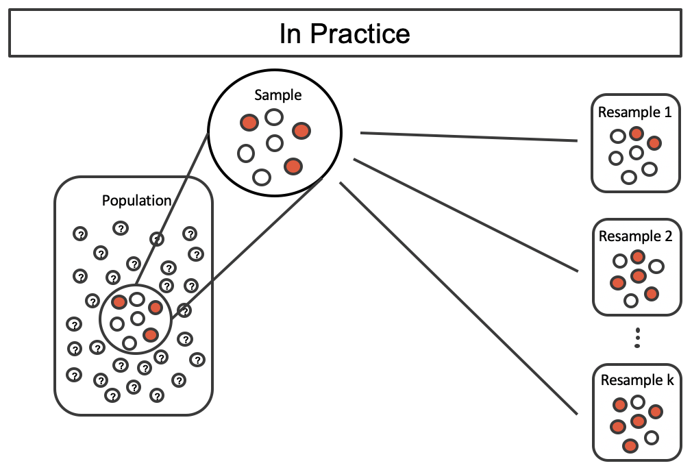

<style>

.reveal {
  font-family: Arial, sans-serif;
}

/* ---------------------------------
   Headings
   --------------------------------- */

.reveal h1,
.reveal h2,
.reveal h3 {
  color: #8B0000;
}

.reveal h2 {
  background-color: #eeeeee;
  padding: 10px 20px;
}

/* ---------------------------------
   Slide numbers
   --------------------------------- */

.reveal .slide-number {
  color: #666666;
  font-size: 0.7em;
}

/* ---------------------------------
   Code
   --------------------------------- */

.reveal pre {
  font-size: 0.65em;
}

.reveal code {
  font-family: "Fira Code", "Courier New", monospace;
}

/* ---------------------------------
   Cascade / incremental reveals
   --------------------------------- */

.reveal .fragment {
  transition: opacity 0.35s ease-in-out;
}

.reveal .fragment.visible {
  opacity: 1;
}

/* ---------------------------------
   Lists
   --------------------------------- */

.reveal ul li,
.reveal ol li {
  margin-bottom: 0.35em;
}

/* ---------------------------------
   Images
   --------------------------------- */

.reveal img {
  max-height: 70vh;
  object-fit: contain;
}

/* Figures 12.1 and 12.2 drawn at the same scale and stacked, so 12.2 only
   adds the resamples on the right */
.reveal .ims-stack {
  display: grid;
  width: 911px;
  margin: 0 auto;
}

.reveal .ims-stack > * {
  grid-area: 1 / 1;
  justify-self: start;
  align-self: start;
  margin: 0;
}

/* Source credit under borrowed figures */
.reveal .ims-credit {
  font-size: 0.45em;
  color: #666666;
}

</style>

```{r}
#| include: false
library(tidyverse)
library(patchwork)
theme_set(theme_minimal(base_size = 16))

uw_red <- "#c5050c"
options(width = 100, pillar.sigfig = 5)   # print every column, and enough digits to see small differences

```

# Today

## Today

::: {.fragment}
**1. Standard errors**

How do we estimate them analytically? What happens when that becomes difficult...
:::

::: {.fragment}
**2. The bootstrap**

Simulate resampling from the **population** by resampling from the **sample**
:::

::: {.fragment}
**3. Illustration: ANES**

Bootstrapping the mean of a feeling thermometer, with resampling and with fractional weights
:::

::: {.fragment}
**4. Statistics beyond the mean**

In the exercise: standard deviations, correlations, medians, and weighted averages.
:::

---

## Data

- **ANES 2024**, pre-election wave: 5,521 respondents
- **Feeling thermometers**: rate a person or party from 0 (cold) to 100 (warm)
- Harris, Trump, Biden, RFK Jr., Vance, Walz, the Democratic Party, the Republican Party
- Plus `weight`, `age`, `gender`, `pid7`, `pid3`

::: {.fragment}
```{r}
anes <- read_csv("data/anes24_therm.csv")
```

:::

---

## Feeling thermometer: Trump

::: {.fragment}
```{r}
anes |> filter(!is.na(ft_trump)) |> ggplot(aes(x=ft_trump)) +
  geom_histogram(bins = nclass.FD) + # Freedman-Diaconis bin number
  labs(x = "Trump Feeling Thermometer (0-100)", y = "Number of Respondents")
```

:::

---

# Standard errors

## The spread of the sampling distribution

- Estimand: $\mu = \mathbb{E}[Y]$. Estimator: $\bar Y$
- Randomness in $\bar Y$ comes from randomness under **repeated sampling**
  - We call the distribution of an estimator the **sampling distribution**
- **Standard error** = the standard deviation of the sampling distribution 
  - For $\bar Y$, we derived $SE(\bar Y) =  \sigma / \sqrt{n}$ 
- Since we never see those other samples, we need to estimate it.

---

## The plug-in standard error

- Plug $\hat\sigma$ in for $\sigma$: $\widehat{\text{SE}} = \hat\sigma / \sqrt{n}$
- So for the mean Trump feeling thermometer:

::: {.fragment}
```{r}
anes |> filter(!is.na(ft_trump)) |>
  summarize(mean_ft_trump = mean(ft_trump),
            n = n(),
            se = sd(ft_trump)/sqrt(n())
  )
```
:::

---

## Do we always need to derive the SE?

- It can be frustrating to derive variances of **other** estimators.
  - Mean is easy...but what about non-i.i.d. means?
  - What about more complicated estimators?
  - Often we have **asymptotic** formulas...but finite sample performance can be poor!
- A popular alternative technique is to use a **computational** procedure that mimics resampling from the target population
  - But we can't re-sample from the population...so we resample from the sample.
  - The **bootstrap**!

---

# The bootstrap

## The plug-in principle

- Lecture: replace the unknown CDF $F$ with the ECDF $\hat F$ to estimate $\theta(F)$
- The SE is also a functional of $F$: the SD of $\hat\theta$ when samples of size $n$ are drawn from $F$
- **Bootstrap**: estimate it by the SD of $\hat\theta$ when samples of size $n$ are drawn from $\hat F$
- Drawing from $\hat F$ = picking respondents uniformly at random **with replacement**
  - This is specifically the "non-parametric" or "pairs" bootstrap (when talking about sampling $Y_i$ and $X_i$ together).

---

## What we want to replicate

::: {.ims-stack}
{.fragment .fade-out fragment-index=1 width="722"}

{.fragment fragment-index=1 width="911"}
:::

::: {.ims-credit}
Figures 12.1 and 12.2 from Mine Çetinkaya-Rundel and Johanna Hardin, [*Introduction to Modern Statistics*](https://openintro-ims.netlify.app/foundations-bootstrapping), 2nd ed. (OpenIntro, 2024), ch. 12. [CC BY-SA 3.0](https://creativecommons.org/licenses/by-sa/3.0/).
:::

---

## What we can replicate

{fig-align="center"}

::: {.ims-credit}
Figure 12.4 from Mine Çetinkaya-Rundel and Johanna Hardin, [*Introduction to Modern Statistics*](https://openintro-ims.netlify.app/foundations-bootstrapping), 2nd ed. (OpenIntro, 2024), ch. 12. [CC BY-SA 3.0](https://creativecommons.org/licenses/by-sa/3.0/).
:::

---

## Generating one bootstrap sample

```{r}
trump <- anes |> filter(!is.na(ft_trump)) |> select(id, ft_trump)

set.seed(812)
boot <- trump |> slice_sample(prop = 1, replace = TRUE)

bind_rows(sample = trump, bootstrap = boot, .id = "data") |>
  group_by(data) |>
  summarize(n = n(), n_unique = n_distinct(id), mean_ft_trump = mean(ft_trump))
```

- `prop = 1`: the same size as the sample. `replace = TRUE`: a respondent can be drawn more than once
- The mean of one bootstrap replication is close to, but not the same as, the sample mean
  - How close depends on the **sampling variance**!

---

## Bootstrapping is random re-weighting

Count how many times each respondent was drawn:

```{r}
draws <- boot |> count(id, name = "W")

trump_w <- trump |>
  left_join(draws, by = "id") |>
  mutate(W = replace_na(W, 0))          # never drawn: weight 0

trump_w |> count(W)
```

---

## Bootstrapping is random re-weighting

The weighted mean of the original sample is the bootstrap mean:

```{r}
trump_w |>
  summarize(bootstrap_mean = mean(boot$ft_trump),
            weighted_mean  = weighted.mean(ft_trump, W))
```

$$
\bar Y^* = \frac{1}{n}\sum_{i=1}^n W_i Y_i, \qquad (W_1, \dots, W_n) \sim \text{Multinomial}\left(n;\ \tfrac{1}{n}, \dots, \tfrac{1}{n}\right)
$$

- **The bootstrap**: Recompute the estimate under a random **perturbation** of the sample
- The weights average to 1 and have variance $1 - 1/n \approx 1$.

---

## Many bootstrap samples

```{r}
boot_mean <- function(data) {
  data |>
    slice_sample(prop = 1, replace = TRUE) |>
    summarize(est = mean(ft_trump)) |>
    pull(est)
}
set.seed(812)
# one row per bootstrap draw; \(b) runs boot_mean(trump) once for each b
boots <- tibble(b = 1:2000) |>
  mutate(est = map_dbl(b, \(b) boot_mean(trump)))
boots |>
  summarize(bootstrap_se = sd(est),
            plug_in_se   = sd(trump$ft_trump) / sqrt(nrow(trump)))
```

- The **bootstrap standard error** is the SD of the 2,000 bootstrap means
  - 2,000 is arbitrary here - We can do more to reduce the **Monte Carlo error**

---

## Some alternative ways of coding the bootstrap

```{r}
set.seed(812)
# a data frame of datasets - unnest and compute on each group -- somewhat memory-inefficient
tibble(b = 1:2000) |>
  mutate(data = map(b, \(b) slice_sample(trump, prop = 1, replace = TRUE))) |>
  unnest(data) |>
  group_by(b) |>
  summarize(est = mean(ft_trump)) |>
  summarize(bootstrap_se = sd(est))
```


---

## Some alternative ways of coding the bootstrap

```{r}
set.seed(812)
# a good-old for loop
est <- rep(NA, 2000)
for (i in 1:2000){
  est[i] <- mean(slice_sample(trump, prop = 1, replace = TRUE)$ft_trump)
}
mean(est)
sd(est)
```


---


## The bootstrap distribution

```{r}
#| fig-height: 3.6
ggplot(boots, aes(x = est)) +
  geom_histogram(aes(y = after_stat(density)), bins = 40, fill = "grey70") +
  geom_function(fun = dnorm, colour = uw_red, linewidth = 1.1,
                args = list(mean = mean(trump$ft_trump), sd = sd(boots$est))) +
  geom_vline(xintercept = mean(trump$ft_trump), linetype = "dashed") +
  labs(x = "Bootstrap mean of the Trump thermometer", y = "Density")
```

- Roughly normal even though $Y$ isn't.
- Centered at $\bar Y$ (dashed)

---

## Two sources of error

- **Sampling variability**: the $n$ respondents that we drew.
- **Monte Carlo error**: how many draws ($B$) we use to approximate the sampling distribution
- More bootstrap iterations only shrink **Monte Carlo error**
  - It can't actually improve the precision of our estimator!
  - We can't draw more observations than $n$ - that's a different data-generating process than the one that made our sample!

---

## Fractional weights

- The bootstrap is just random weights. Those weights don't have to be integers.
- **Fractional-weighted bootstrap**: $W_i = n \cdot E_i / \sum_j E_j$ with $E_i \overset{\text{iid}}{\sim} \text{Exp}(1)$

::: {.fragment}
```{r}
y <- trump$ft_trump
n <- length(y)
set.seed(812)
e <- rexp(n)
w_frac <- n * e / sum(e)                              # normalized exponential weights
w_mult <- as.vector(rmultinom(1, n, rep(1 / n, n)))   # the counts from resampling
weights <- tibble(multinomial = w_mult, fractional = w_frac) |>
  pivot_longer(everything(), names_to = "type", values_to = "W")
weights |>
  group_by(type) |>
  summarize(mean = mean(W), var = var(W), share_zero = mean(W == 0))
```
:::

---

## Two kinds of weights

```{r}
#| fig-height: 3.6
ggplot(weights, aes(x = W)) +
  geom_histogram(binwidth = 0.1, boundary = 0, fill = "grey60") +
  facet_wrap(~ type) +
  coord_cartesian(xlim = c(0, 6)) +
  labs(x = "Weight on a respondent", y = "Respondents")
```

- Same mean (1) and nearly identical variances.
- Fractional weights are also **never 0** - we keep every respondent.
  - Useful in cases where we have parameters tied to respondents (e.g. "fixed effects" regressions).

---

## Fractional weights: same answer

```{r}
set.seed(812)
# weighted.mean() rescales the weights to sum to 1.
fracs <- tibble(b = 1:2000) |>
  mutate(est = map_dbl(b, \(b) weighted.mean(y, rexp(n))))

bind_rows(bootstrap = boots, fractional = fracs, .id = "type") |>
  group_by(type) |>
  summarize(se = sd(est))
```

---

## The bootstrap recipe for the standard error

1. Draw a sample of size $n$ from the sample **with replacement**
2. Recompute the estimate **on that sample**
3. Repeat 1-2 some large number of times and take the standard deviation

---

## Recap

- We need to estimate the standard error (the SD of the sampling distribution) to obtain confidence intervals + do hypothesis tests.
  - **Plug-in**: derive the formula, plug-in estimators for unknown features.
  - **Bootstrap**: recompute the estimate under random weights on the observations. Don't need to derive $SE(\hat{\theta})$.
- When does it work?
  - When the estimator is a **smooth** functional of the CDF.
- Other extensions of the bootstrap you'll see!
  - **Cluster** bootstrap (instead of resampling observations, resample clusters)
  - **Wild** bootstrap (random multipliers (positive/negative) on each observation's *deviations* from the estimate)

---

# Exercise

## Exercise

Open `ps812_section7_exercise.qmd`.

- Part 1: the plug-in standard error
- Part 2: implementing the non-parametric + fractional-weighted bootstrap
- Part 3: other estimators!

---

# Questions?
