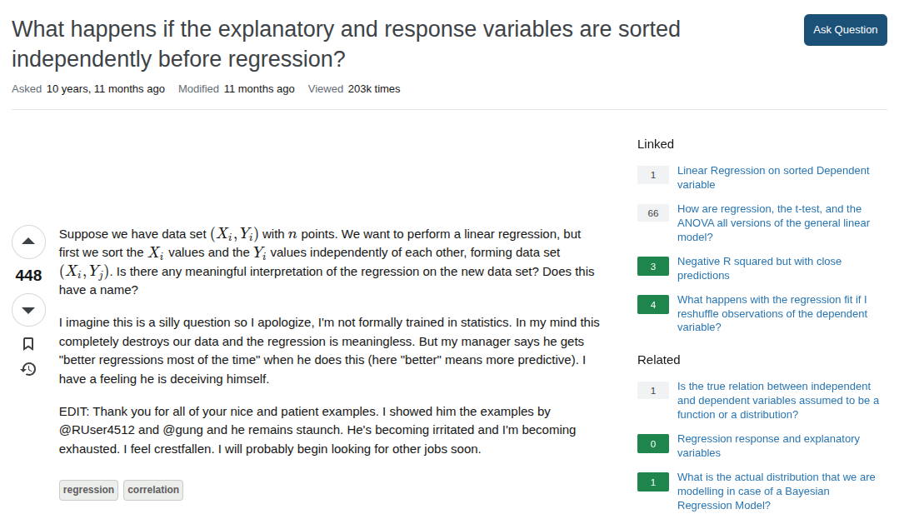

## Welcome back! {.title-slide}

<!-- MathJax macros for the whole deck. The reveal math plugin overwrites
     window.MathJax, so a header config would be clobbered; defining them in
     the first slide registers them before any later slide is typeset. The
     wrapper takes up no space and renders nothing. -->
::: {style="position:absolute;width:0;height:0;overflow:hidden;opacity:0"}
$$
\newcommand{\Var}{\text{Var}}
\newcommand{\Cov}{\text{Cov}}
\newcommand{\Corr}{\text{Corr}}
\newcommand{\indep}{\mathrel{\perp\mkern-10mu\perp}}
$$
:::

```{r}
#| label: setup
#| include: false
#| message: false

# Carried over from week 10: the data, the plot theme, the fits and the party
# colors
library(tidyverse)
library(sandwich)
options(width = 110)    # the code font is small, so let printed output run wider
# Paint the figure device the slide color, so plots with a fixed aspect ratio
# (coord_equal) don't sit in a white box
knitr::opts_chunk$set(dev.args = list(bg = "#F7F7F7"))

# 2024 ANES: the Trump thermometer and the four-item hostile sexism scale
# (data/prepare_data.R builds the extract from the full release)
anes <- read_csv("data/anes24_sexism.csv") |>
  filter(!is.na(ft_trump), !is.na(hostile_sexism)) |>
  mutate(party = case_when(pid7 <= 3 ~ "Democrat", pid7 == 4 ~ "Independent",
                           pid7 >= 5 ~ "Republican"))

theme_reg <- theme_minimal(base_size = 18) +
  theme(panel.grid = element_blank(),
        axis.line = element_line(colour = "#333333"),
        strip.text = element_text(face = "bold"),
        plot.background = element_rect(fill = "#F7F7F7", colour = NA))

fit_hs <- lm(ft_trump ~ hostile_sexism, data = anes)
fit_rr <- lm(ft_trump ~ hostile_sexism + racial_resentment, data = anes)
fit_pint <- lm(ft_trump ~ hostile_sexism * party, data = anes)
f1 <- function(x) sprintf("%.1f", x)

party_cols <- c(Democrat = "#0479a8", Independent = "#b8860b", Republican = "#c5050c")
```

<!-- ============================================================
     Recap: regression in three dimensions, as a projection, and FWL
     ============================================================ -->

## Regression {.plane-slide}

```{r}
#| label: reg-setup
#| include: false

# A simulated sample for the regression animation (reg-anim/reg.js). Y depends
# equally on two latent traits, Z1 and Z2, but we only see X1, a precise
# measure of Z1, and X2, a very noisy one of Z2 (about half of its variance is
# noise). The noisy covariate's slope comes out attenuated: the plane is steep
# along X1 and much flatter along X2, though Z1 and Z2 matter equally
set.seed(812)
n_sim <- 60
z1 <- rnorm(n_sim)
z2 <- 0.4 * z1 + sqrt(1 - 0.4^2) * rnorm(n_sim)
sim <- tibble(x1 = 5 + 1.6 * (z1 + rnorm(n_sim, 0, 0.15)),
              x2 = 5 + 1.6 * (z2 + rnorm(n_sim, 0, 1)),
              y  = 50 + 10 * z1 + 10 * z2 + rnorm(n_sim, 0, 6))
fit_sim <- lm(y ~ x1 + x2, data = sim)
b_sim <- coef(fit_sim)

# One scene for every 3D slide: the cloud and its plane, then three rows
# (50, 40 and 34, which become observation axes 1, 2 and 3) turned into
# vectors for the projection picture, then back to the whole cloud for FWL. These three were picked so the
# vectors' geometry reads well: X1 and X2 at about 45 degrees, Y well off
# their plane. Each slide plays stages `from` to `to`; `stages` swaps in a
# different list of states and `readout` reports the sums of squares
reg_data <- jsonlite::toJSON(list(x1 = sim$x1, x2 = sim$x2, y = sim$y, beta = unname(b_sim),
                                  idx = c(50, 40, 34) - 1), digits = NA)
reg_anim <- function(from, to, stages = NULL, readout = FALSE) {
  o <- list(from = from, to = to, readout = readout)
  if (!is.null(stages)) o$stages <- stages
  cat("```{=html}",
      '<div class="rg-anim"></div>',
      "<script>",
      "(", readLines("reg-anim/reg.js"), ")(document.currentScript.previousElementSibling,",
      reg_data, ",", jsonlite::toJSON(o, auto_unbox = TRUE), ");",
      "</script>",
      rep('<span class="fragment rg-step"></span>', to - from),
      "```", sep = "\n")
}
```

```{r}
#| echo: false
#| output: asis
reg_anim(0, 3)
```

## Regression is a projection {.plane-slide}

```{r}
#| echo: false
#| output: asis
reg_anim(3, 9)
```

## Frisch-Waugh-Lovell {.plane-slide}

```{r}
#| echo: false
#| output: asis
reg_anim(9, 13)
```

## The geometry of least squares

::: {.incremental}

- The **column space** of $\mathbf{X}$ is every linear combination of its columns

  $$\mathcal{C}(\mathbf{X}) = \{\mathbf{X}\mathbf{b} : \mathbf{b} \in \mathbb{R}^k\}$$

  - Every possible vector of **linear predictions** of $\mathbf{Y}$ from $\mathbf{X}$

- $\hat{\mathbf{Y}} = \mathbf{X}\hat{\boldsymbol{\beta}}$ is the point in $\mathcal{C}(\mathbf{X})$ **closest** to $\mathbf{Y}$: its **projection**

- The shortest path from a point to a plane meets it at a **right angle**, so the residual is **orthogonal** to every column of $\mathbf{X}$

  $$\mathbf{X}^\prime\hat{\mathbf{e}} = \mathbf{X}^\prime(\mathbf{Y} - \mathbf{X}\hat{\boldsymbol{\beta}}) = \mathbf{0}$$

- With an intercept: $\sum_i \hat{e}_i = 0$ and $\sum_i \hat{e}_i X_{ij} = 0$ for every covariate.

:::

## The hat matrix

::: {.incremental}

- Solving the normal equations and multiplying through by $\mathbf{X}$

  $$\hat{\mathbf{Y}} = \mathbf{X}\hat{\boldsymbol{\beta}} = \underbrace{\mathbf{X}(\mathbf{X}^\prime\mathbf{X})^{-1}\mathbf{X}^\prime}_{\mathbf{P}}\,\mathbf{Y}$$

- $\mathbf{P}$ is the $n \times n$ **projection matrix** onto the **column space** of $\mathbf{X}$
  - Also called the **hat matrix**: it "puts the hat on" $\mathbf{Y}$

- Multiplying **any** vector by $\mathbf{P}$ gives its best linear prediction from $\mathbf{X}$
  - $\mathbf{P}\mathbf{Z}$ = the fitted values from regressing $\mathbf{Z}$ on $\mathbf{X}$

:::

## Properties of the hat matrix

::: {.incremental}

- **Leaves $\mathcal{C}(\mathbf{X})$ alone**: anything already in the column space is its own projection

  $$\mathbf{P}\mathbf{X} = \mathbf{X}(\mathbf{X}^\prime\mathbf{X})^{-1}\mathbf{X}^\prime\mathbf{X} = \mathbf{X}$$

- **Idempotent**: projecting twice is the same as projecting once, $\mathbf{P}\mathbf{P} = \mathbf{P}$
  - Regressing the fitted values on $\mathbf{X}$ returns the same fitted values

- **Symmetric**: $\mathbf{P}^\prime = \mathbf{P}$

- **Trace** (sum of the diagonals) equals the number of parameters $k$

  $$\text{tr}(\mathbf{P}) = \text{tr}\big(\mathbf{X}(\mathbf{X}^\prime\mathbf{X})^{-1}\mathbf{X}^\prime\big) = \text{tr}\big((\mathbf{X}^\prime\mathbf{X})^{-1}\mathbf{X}^\prime\mathbf{X}\big) = \text{tr}(\mathbf{I}_k) = k$$


:::

## The residual maker

::: {.incremental}

- The complement of $\mathbf{P}$ is the **annihilator** or **residual maker**

  $$\mathbf{M} = \mathbf{I}_n - \mathbf{P} \qquad \mathbf{M}\mathbf{Y} = \mathbf{Y} - \hat{\mathbf{Y}} = \hat{\mathbf{e}}$$

- It projects onto everything **orthogonal** to $\mathcal{C}(\mathbf{X})$
  - **Annihilates** $\mathbf{X}$: $\mathbf{M}\mathbf{X} = \mathbf{X} - \mathbf{P}\mathbf{X} = \mathbf{0}$
  - Also symmetric and idempotent, with $\text{tr}(\mathbf{M}) = n - k$
  - $\mathbf{P}\mathbf{M} = \mathbf{0}$: the fitted values and the residuals are **orthogonal**

- Every outcome vector splits into two **perpendicular** pieces

  $$\mathbf{Y} = \mathbf{P}\mathbf{Y} + \mathbf{M}\mathbf{Y} = \hat{\mathbf{Y}} + \hat{\mathbf{e}} \qquad \Vert\mathbf{Y}\Vert^2 = \Vert\hat{\mathbf{Y}}\Vert^2 + \Vert\hat{\mathbf{e}}\Vert^2$$

  - The part that's **explained** by $\mathbf{X}$ and the part that isn't explained by $\mathbf{X}$

:::

<!-- ============================================================
     Wald tests (Blackwell 2025, Section 8.3)
     ============================================================ -->

## Testing more than one coefficient

::: {.incremental}

- Recall the party interaction model from last week

  $$Y_i = \beta_0 + \beta_1 \text{HS}_i + \beta_2 \text{Ind}_i + \beta_3 \text{Rep}_i + \beta_4 (\text{HS}_i \times \text{Ind}_i) + \beta_5 (\text{HS}_i \times \text{Rep}_i) + e_i$$

- Does the slope on hostile sexism **differ by party at all**?

  $$H_0: \beta_4 = 0 \text{ and } \beta_5 = 0 \qquad H_1: \beta_4 \neq 0 \text{ or } \beta_5 \neq 0$$

- Is hostile sexism related to the thermometer **in any party**?

  $$H_0: \beta_1 = \beta_4 = \beta_5 = 0$$

- Each null puts **several** restrictions on the coefficients at once

:::

## Why not just use the individual $t$-tests?

```{r}
#| label: wald-setup
#| include: false
V_pint <- vcovHC(fit_pint, type = "HC0")
b_pint <- coef(fit_pint)
se_pint <- sqrt(diag(V_pint))
```

::: {.incremental}

- "Reject if **either** $t$-test rejects" is a **multiple testing** problem
  - Two tests at $\alpha = 0.05$: the chance that at least one rejects under the joint null is **above** 5%

- The two estimates are **correlated** - we can and should incorporate that into the test.

- The individual tests and the joint test can **disagree**
  - Here: $t = `r sprintf("%.2f", b_pint[5] / se_pint[5])`$ for $\hat{\beta}_4$ and $t = `r sprintf("%.2f", b_pint[6] / se_pint[6])`$ for $\hat{\beta}_5$
  - Two "almost significant" coefficients can be jointly significant or not.

:::

## Linear hypotheses: $\mathbf{R}\boldsymbol{\beta} = \mathbf{r}$

::: {.incremental}

- We can write a joint hypothesis as a set of **restrictions** on the coefficients.
- For a **linear** set of restrictions, we can express this as a matrix product:

  $$H_0: \underbrace{\mathbf{R}}_{q \times k}\ \underbrace{\boldsymbol{\beta}}_{k \times 1} = \underbrace{\mathbf{r}}_{q \times 1}$$

  - Each **row** of $\mathbf{R}$ is one restriction: a linear combination of the coefficients
  - $q$ is the **number of restrictions**

- "No difference in slopes by party": $\beta_4 = \beta_5 = 0$

  $$\mathbf{R} = \begin{pmatrix} 0 & 0 & 0 & 0 & 1 & 0 \\ 0 & 0 & 0 & 0 & 0 & 1 \end{pmatrix} \qquad \mathbf{r} = \begin{pmatrix} 0 \\ 0 \end{pmatrix}$$

:::

## Examples of $\mathbf{R}$ and $\mathbf{r}$

::: {.incremental}

- No relationship with hostile sexism in any party, $\beta_1 = \beta_4 = \beta_5 = 0$ ($q = 3$)

  $$\mathbf{R} = \begin{pmatrix} 0 & 1 & 0 & 0 & 0 & 0 \\ 0 & 0 & 0 & 0 & 1 & 0 \\ 0 & 0 & 0 & 0 & 0 & 1 \end{pmatrix} \qquad \mathbf{r} = \begin{pmatrix} 0 \\ 0 \\ 0 \end{pmatrix}$$

- The slope among **Republicans** is zero, $\beta_1 + \beta_5 = 0$ ($q = 1$)

  $$\mathbf{R} = \begin{pmatrix} 0 & 1 & 0 & 0 & 0 & 1 \end{pmatrix} \qquad \mathbf{r} = 0$$

- Independents and Republicans have the **same** slope, $\beta_4 = \beta_5$ ($q = 1$)

  $$\mathbf{R} = \begin{pmatrix} 0 & 0 & 0 & 0 & 1 & -1 \end{pmatrix} \qquad \mathbf{r} = 0$$

:::

## The sampling distribution of $\mathbf{R}\hat{\boldsymbol{\beta}}$

::: {.incremental}

- $\mathbf{R}\hat{\boldsymbol{\beta}}$ is a **linear function** of an asymptotically normal vector, so it's asymptotically normal too

  $$\mathbf{R}\hat{\boldsymbol{\beta}} \overset{a}{\sim} \mathcal{N}\big(\mathbf{R}\boldsymbol{\beta},\ \mathbf{R}\,\Var(\hat{\boldsymbol{\beta}})\,\mathbf{R}^\prime\big)$$

  - $\mathbf{R}\,\Var(\hat{\boldsymbol{\beta}})\,\mathbf{R}^\prime$ is the $q \times q$ variance-covariance matrix of the restricted combinations

- Plug in our estimate (e.g. the HC0 **robust** variance), $\widehat{\mathbf{V}} = \widehat{\Var}(\hat{\boldsymbol{\beta}})$

- Under $H_0$, $\mathbf{R}\hat{\boldsymbol{\beta}} - \mathbf{r}$ should be **close to zero**

:::

## The Wald statistic

::: {.incremental}

- Let's construct a **single** statistic to build our test around.
- Take **squared distance** from the null $\mathbf{r}$, scaled by the **variance-covariance matrix**

  $$W = (\mathbf{R}\hat{\boldsymbol{\beta}} - \mathbf{r})^\prime\,\big(\mathbf{R}\widehat{\mathbf{V}}\mathbf{R}^\prime\big)^{-1}\,(\mathbf{R}\hat{\boldsymbol{\beta}} - \mathbf{r})$$

  - Without the middle matrix, this is just plain Euclidean distance
  - The inverse variance **rescales** each deviation by how noisy it is and **uncorrelates** them
  - The matrix version of dividing by the variance gives a squared **Mahalanobis** distance

- With one restriction ($q = 1$), $W$ is exactly $t^2$ - our familiar univariate test statistic squared. 

- Large values of $W$ are evidence **against** $H_0$

:::

## Why weight by the covariance?

```{r}
#| echo: false
#| fig-width: 12
#| fig-height: 4.9
#| fig-align: center

# Blackwell (2025), Figure 8.1, redrawn: contours of a hypothetical joint
# sampling distribution of two coefficients with correlation 0.8. The circle
# is closer to the center in plain distance; the triangle is closer once the
# correlation is taken into account
mu <- c(1, 2)
S <- matrix(c(1, 0.8, 0.8, 1), 2)
Si <- solve(S)
grid_c <- expand_grid(b1 = seq(-2.2, 4.2, length.out = 220), b2 = seq(-1.2, 5.2, length.out = 220)) |>
  mutate(m = map2_dbl(b1, b2, \(a, b) { v <- c(a, b) - mu; drop(t(v) %*% Si %*% v) }))
pts <- tibble(b1 = c(0.1, 2.5), b2 = c(2.9, 3.5), shape = c("circle", "triangle")) |>
  mutate(euc = sqrt((b1 - mu[1])^2 + (b2 - mu[2])^2),
         wald = map2_dbl(b1, b2, \(a, b) { v <- c(a, b) - mu; drop(t(v) %*% Si %*% v) }),
         lab = sprintf("distance %.2f\nW = %.2f", euc, wald),
         lx = c(-1.6, 4.2), ly = c(3.6, 5.0))
ggplot(grid_c, aes(b1, b2)) +
  geom_contour(aes(z = m), breaks = c(0.5, 1, 2, 4, 6, 9), colour = "#0479a8", linewidth = 0.9) +
  annotate("point", x = mu[1], y = mu[2], size = 3, colour = "#333333") +
  geom_point(data = pts, aes(shape = shape), size = 6, colour = "#c5050c", stroke = 1.6, fill = "#F7F7F7") +
  geom_text(data = pts, aes(lx, ly, label = lab), size = 5.5, colour = "#c5050c", lineheight = 0.9) +
  scale_shape_manual(values = c(circle = 21, triangle = 24), guide = "none") +
  coord_equal(xlim = c(-2.7, 5.2), ylim = c(-1.2, 5.4)) +
  labs(x = expression(hat(beta)[1]), y = expression(hat(beta)[2])) +
  theme_reg
```

::: {.attribution}
Modelled after Blackwell (2025), Figure 8.1
:::

## The $\chi^2_q$ distribution

```{r}
#| echo: false
#| fig-width: 12
#| fig-height: 3.6
#| fig-align: center

# Chi-squared densities for q = 1, 2, 3, 5 with each 95% critical value
qs <- c(1, 2, 3, 5)
chi_d <- expand_grid(q = qs, w = seq(0.02, 14, 0.02)) |>
  mutate(dens = dchisq(w, q), lab = factor(paste0("q = ", q), paste0("q = ", qs)))
chi_c <- tibble(q = qs, crit = qchisq(0.95, qs), lab = factor(paste0("q = ", q), paste0("q = ", qs)))
ggplot(chi_d, aes(w, dens, colour = lab)) +
  geom_line(linewidth = 1.3) +
  geom_vline(data = chi_c, aes(xintercept = crit, colour = lab), linetype = "dashed", linewidth = 0.8) +
  geom_text(data = chi_c, aes(x = crit, y = 0.52, label = sprintf("%.2f", crit)), hjust = -0.1, size = 5, show.legend = FALSE) +
  scale_colour_manual(values = c("#333333", "#0479a8", "#b8860b", "#c5050c"), name = NULL) +
  coord_cartesian(ylim = c(0, 0.55)) +
  labs(x = "W", y = "Density") +
  theme_reg + theme(legend.position = "right")
```

::: {.incremental}

- Under $H_0$, $W \xrightarrow{d} \chi^2_q$: the sum of $q$ **independent squared** standard normals
  - Standardizing by $(\mathbf{R}\widehat{\mathbf{V}}\mathbf{R}^\prime)^{-1}$ turns the $q$ deviations into $q$ uncorrelated normals with variance $1$
- Reject at level $\alpha$ when $W > \chi^2_{q, 1 - \alpha}$. Our rejection region is **one-sided** since $W \geq 0$ (`qchisq(0.95, df = q)`)

:::

## Example: do the party interactions matter?

```{r}
V_pint <- vcovHC(fit_pint, type = "HC0")       # robust variance-covariance matrix
b_pint <- coef(fit_pint)
se_pint <- sqrt(diag(V_pint))
round(cbind(estimate = b_pint, se = se_pint, t = b_pint / se_pint), 3)
```

::: {.incremental}

- Neither interaction is individually significant at 5%, but $\hat{\beta}_5$ is close
- What about **both together**?

:::

## Wald tests by hand

```{r}
R <- rbind(c(0, 0, 0, 0, 1, 0),                # hostile_sexism:partyIndependent
           c(0, 0, 0, 0, 0, 1))                # hostile_sexism:partyRepublican
r <- c(0, 0)

dev <- R %*% b_pint - r                        # q x 1 deviations from the null
W <- drop(t(dev) %*% solve(R %*% V_pint %*% t(R)) %*% dev)
c(W = W, critical = qchisq(0.95, df = 2), p = pchisq(W, df = 2, lower.tail = FALSE))
```

::: {.incremental}

- We **fail to reject** the null that the hostile sexism slope is the same in all three parties
- And for the null that hostile sexism is unrelated to the thermometer in **every** party?

:::

::: {.fragment}

```{r}
R3 <- rbind(c(0, 1, 0, 0, 0, 0), c(0, 0, 0, 0, 1, 0), c(0, 0, 0, 0, 0, 1))
dev3 <- R3 %*% b_pint
W3 <- drop(t(dev3) %*% solve(R3 %*% V_pint %*% t(R3)) %*% dev3)
c(W = round(W3, 1), critical = round(qchisq(0.95, df = 3), 2), p = format.pval(pchisq(W3, df = 3, lower.tail = FALSE)))
```

:::

## Wald tests in R

- `marginaleffects::hypotheses()` implements a variety of null hypothesis tests
  - Coefficient names are in `joint`
  - Select a variance estimator with `vcov`

```{r}
library(marginaleffects)
hypotheses(fit_pint,
           joint = c("hostile_sexism:partyIndependent", "hostile_sexism:partyRepublican"),
           vcov = "HC0", joint_test = "chisq")
```

::: {.incremental}

- Careful: `joint_test` defaults to the $F$ test, and `vcov` defaults to the **classical** variance.
- `vcov` takes `"HC0"` through `"HC3"`, a clustering formula for clustered SEs `~ state`, or a matrix computed elsewhere (like `sandwich`).

:::

## Wald tests and $F$-tests

::: {.incremental}

- What regression software reports by default is an **$F$-statistic**

  $$F = \frac{W}{q}$$

  - Almost always using **classical** (homoskedastic) standard errors and compared against an $F_{q,\, n-k}$ distribution
  - This test is exact **only** under homoskedastic, normal errors

- In large samples $q \cdot F_{q, n-k}$ and $\chi^2_q$ are equivalent. 
  - The $F$ is a slightly more **conservative** small-sample correction

- The $F$-test at the bottom of `summary(lm())` tests that **every** coefficient except the intercept is zero
  - Rarely an interesting hypothesis!

:::

::: {.fragment}

```{r}
fit_add <- lm(ft_trump ~ hostile_sexism + party, data = anes)
anova(fit_add, fit_pint)                       # classical F-test of the two interactions
```

:::

## One restriction: $W = t^2$

::: {.incremental}

- With a single restriction, $\mathbf{R}$ is a $1 \times k$ row and $r$ is a number, so $W$ is a **scalar**

  $$W = \frac{(\mathbf{R}\hat{\boldsymbol{\beta}} - r)^2}{\mathbf{R}\widehat{\mathbf{V}}\mathbf{R}^\prime} = \left(\frac{\mathbf{R}\hat{\boldsymbol{\beta}} - r}{\widehat{SE}(\mathbf{R}\hat{\boldsymbol{\beta}})}\right)^2 = t^2$$

- And $\chi^2_1$ is the distribution of a **squared** standard normal
  - $\chi^2_{1, 0.95} = 3.84 = 1.96^2$
  - The Wald test with $q = 1$ **is** the two-sided $t$-test

- So the $t$-test works for **any** linear combination, with standard error

  $$\widehat{SE}(\mathbf{R}\hat{\boldsymbol{\beta}}) = \sqrt{\mathbf{R}\widehat{\mathbf{V}}\mathbf{R}^\prime} = \sqrt{\sum_j R_j^2 \widehat{\Var}(\hat{\beta}_j) + 2\sum_{j < l} R_j R_l \widehat{\Cov}(\hat{\beta}_j, \hat{\beta}_l)}$$

  - E.g. the **sum** of two coefficients: don't forget the **covariance**!

  $$\widehat{SE}(\hat{\beta}_1 + \hat{\beta}_5) = \sqrt{\widehat{\Var}(\hat{\beta}_1) + \widehat{\Var}(\hat{\beta}_5) + 2\,\widehat{\Cov}(\hat{\beta}_1, \hat{\beta}_5)}$$

:::

## Testing a linear combination

- The slope among **Republicans** is $\beta_1 + \beta_5$, and the difference between Independents and Republicans is $\beta_4 - \beta_5$

```{r}
lin_comb <- function(R, b, V) {
  est <- sum(R * b)                           # R b-hat
  se <- sqrt(drop(R %*% V %*% R))             # R V R', covariances included
  c(estimate = est, se = se, t = est / se, W = (est / se)^2,
    lower = est - qnorm(0.975) * se, upper = est + qnorm(0.975) * se)
}
round(rbind(
  republican_slope = lin_comb(c(0, 1, 0, 0, 0, 1), b_pint, V_pint),
  ind_minus_rep    = lin_comb(c(0, 0, 0, 0, 1, -1), b_pint, V_pint)
), 3)
```

::: {.fragment}

```{r}
hypotheses(fit_pint, hypothesis = "hostile_sexism + `hostile_sexism:partyRepublican` = 0", vcov = "HC0")
```

:::

::: {.incremental}

- The covariance term matters: $\widehat{\Cov}(\hat{\beta}_1, \hat{\beta}_5) = `r sprintf("%.2f", V_pint[2, 6])`$ is large and negative

:::

## Confidence regions

```{r}
#| echo: false
#| fig-width: 12
#| fig-height: 4.3
#| fig-align: center

# The 95% Wald confidence region for the two interactions, an ellipse, against
# the box made by the two individual 95% intervals
idx <- c(5, 6)
b2 <- b_pint[idx]
V2 <- V_pint[idx, idx]
L <- t(chol(V2))
th <- seq(0, 2 * pi, length.out = 300)
ell <- t(b2 + sqrt(qchisq(0.95, 2)) * L %*% rbind(cos(th), sin(th)))
ell <- tibble(b4 = ell[, 1], b5 = ell[, 2])
box <- tibble(lo4 = b2[1] - 1.96 * sqrt(V2[1, 1]), hi4 = b2[1] + 1.96 * sqrt(V2[1, 1]),
              lo5 = b2[2] - 1.96 * sqrt(V2[2, 2]), hi5 = b2[2] + 1.96 * sqrt(V2[2, 2]))
ggplot() +
  geom_rect(data = box, aes(xmin = lo4, xmax = hi4, ymin = lo5, ymax = hi5),
            fill = NA, colour = "#646569", linetype = "dashed", linewidth = 0.9) +
  geom_polygon(data = ell, aes(b4, b5), fill = "#0479a8", alpha = 0.18, colour = "#0479a8", linewidth = 1.2) +
  annotate("point", x = b2[1], y = b2[2], size = 3.5, colour = "#0479a8") +
  annotate("point", x = 0, y = 0, size = 4, shape = 4, stroke = 2, colour = "#c5050c") +
  annotate("text", x = -1.2, y = 1.6, label = "H₀: β₄ = β₅ = 0", colour = "#c5050c", size = 5.5, hjust = 1) +
  annotate("text", x = box$hi4, y = box$hi5 + 1, label = "individual 95% intervals", colour = "#646569",
           size = 5, hjust = 1) +
  labs(x = "HS × Independent", y = "HS × Republican") +
  coord_equal() +
  theme_reg
```

::: {.incremental}

- **Invert** the Wald test. Our confidence region contains every $\mathbf{b}$ we **wouldn't** reject

  $$\big\{\mathbf{b} : (\mathbf{R}\hat{\boldsymbol{\beta}} - \mathbf{b})^\prime(\mathbf{R}\widehat{\mathbf{V}}\mathbf{R}^\prime)^{-1}(\mathbf{R}\hat{\boldsymbol{\beta}} - \mathbf{b}) \leq \chi^2_{q, 0.95}\big\}$$

  - An **ellipse** stretched along the noisier coefficient and tilted by the correlation.

:::

<!-- ============================================================
     Goodness of fit (Blackwell 2025, Section 7.2)
     ============================================================ -->

## How well does the regression fit? {.plane-slide}

```{r}
#| echo: false
#| output: asis
reg_anim(0, 2, readout = TRUE,
         stages = list(list(A = 1, pl = 1, tilt = 0),             # a flat plane at the mean of Y
                       list(A = 1, pl = 1, tilt = 0, rs = 1),     # its residuals: TSS
                       list(A = 1, pl = 1, tilt = 1, rs = 1)))    # tilted to OLS: SSR
```

## $R^2$

::: {.incremental}

- **Without** covariates, our best predictor is the **mean**. What's left over is the **total** sum of squares

$$TSS = \sum_{i=1}^n (Y_i - \bar{Y})^2$$

- **With** covariates, our best linear predictor is the OLS fit. What's left over is the **sum of squared residuals**

  $$SSR = \sum_{i=1}^n (Y_i - \mathbf{X}_i^\prime\hat{\boldsymbol{\beta}})^2$$

- The **coefficient of determination** ($R^2$) is the share of the prediction error removed by using $\mathbf{X}_i$ over just the intercept.

  $$R^2 = \frac{TSS - SSR}{TSS} = 1 - \frac{SSR}{TSS}$$

- $0 \leq R^2 \leq 1$. Adding covariates is never **worse** than the mean (in-sample). And it can never explain more than what's there to explain!

:::

## $R^2$ 

```{r}
fit_full <- lm(ft_trump ~ hostile_sexism + racial_resentment + party, data = anes)
fits <- list(`HS` = fit_hs, `HS + RR` = fit_rr, `HS + RR + party` = fit_full, `HS x party` = fit_pint)
round(sapply(fits, \(f) c(R2 = summary(f)$r.squared, adj_R2 = summary(f)$adj.r.squared)), 3)
```

::: {.incremental}

- Hostile sexism **alone** removes about `r round(100 * summary(fit_hs)$r.squared)`% of the squared prediction error. Adding racial resentment and party brings it to `r round(100 * summary(fit_full)$r.squared)`%.

:::

::: {.fragment}

- But $R^2$ can **never** go down when we add a covariate, even pure noise

```{r}
set.seed(812)
noise <- matrix(rnorm(nrow(anes) * 100), ncol = 100)    # 100 columns of random numbers
fit_noise <- lm(anes$ft_trump ~ anes$hostile_sexism + noise)
round(c(R2 = summary(fit_hs)$r.squared, R2_with_noise = summary(fit_noise)$r.squared), 4)
```

:::

## What $R^2$ does and doesn't tell us

::: {.incremental}

- OLS **minimizes** SSR in the sample, so adding predictors can only improve the fit **in-sample**
  - **Adjusted** $R^2 = 1 - \frac{SSR/(n-k)}{TSS/(n-1)}$ penalizes the $R^2$ for each additional parameter, but it's an ad-hoc correction.
  - Rather, we evaluate prediction quality by looking **out of sample** (e.g. **leave-one-out** cross-validation)

- A **low** $R^2$ does **not** mean the coefficients are wrong or uninteresting
  - Lots of $Y$ varies for reasons unrelated to $\mathbf{X}$. That's fine if we care about $\beta_j$

- A **high** $R^2$ does **not** mean the CEF is linear, the model is "right," or the coefficients are causal

:::

## "Better regressions most of the time"

{fig-align="center" width="85%"}


## "Better regressions most of the time"

{fig-align="center" width="80%"}


<!-- ============================================================
     Leverage and influence (Blackwell 2025, Section 7.9)
     ============================================================ -->

## Outliers, leverage, and influence

::: {.incremental}

- OLS minimizes **squared** residuals, so it works hardest to shrink the **biggest** ones

- With an intercept, the fit always passes through the **means**: $\bar{Y} = \bar{\mathbf{X}}^\prime\hat{\boldsymbol{\beta}}$
  - Points near $\bar{\mathbf{X}}$ can shift the line **up or down** but can't **tilt** it much
  - Points far from $\bar{\mathbf{X}}$ can move the "lever" a lot.

- **Influence** consists of two elements:
  1. **Leverage**: $\mathbf{X}_i$ is extreme - far from $\bar{\mathbf{X}}$
  2. An **outlier**: $Y_i$ far from where the **other** observations would predict it to be

:::

## Leverage

::: {.incremental}

- The **leverage** of observation $i$ is the $i$th **diagonal** of the hat matrix

  $$h_{ii} = \mathbf{X}_i^\prime(\mathbf{X}^\prime\mathbf{X})^{-1}\mathbf{X}_i = [\mathbf{P}]_{ii}$$

- Recall $\hat{\mathbf{Y}} = \mathbf{P}\mathbf{Y}$, so every fitted value is a weighted sum of **all** the outcomes

  $$\hat{Y}_i = \sum_{j=1}^n h_{ij}Y_j = h_{ii}Y_i + \sum_{j \neq i} h_{ij} Y_j$$

  - $h_{ij}$: how much $Y_j$ moves the fitted value for $i$
  - $h_{ii}$: how much $Y_i$ moves **its own** fitted value

- In a **bivariate** regression

  $$h_{ii} = \frac{1}{n} + \frac{(X_i - \bar{X})^2}{\sum_{j=1}^n (X_j - \bar{X})^2}$$

:::

## Properties of leverage

::: {.incremental}

- $0 \leq h_{ii} \leq 1$, and $h_{ii} \geq 1/n$

- Leverages **sum** to the number of regressors: $\sum_{i} h_{ii} = \text{tr}(\mathbf{P}) = k$
  - So the **average** leverage is $k / n$, which vanishes as $n$ grows

- $h_{ii} = 1$: the fit passes **exactly** through $Y_i$
  - E.g. the only observation in a category that gets its own dummy


:::

## Where is leverage high?

```{r}
#| echo: false
#| fig-width: 12
#| fig-height: 4.3
#| fig-align: center

# Leverage in the party interaction model: each party has its own line, so
# leverage is distance from that party's mean hostile sexism, scaled by how
# few respondents the party has
lev <- tibble(fit_pint$model, h = hatvalues(fit_pint))
k_n <- length(coef(fit_pint)) / nobs(fit_pint)
ggplot(lev, aes(hostile_sexism, h, colour = party)) +
  geom_hline(yintercept = k_n, colour = "#646569") +
  geom_hline(yintercept = 2 * k_n, colour = "#646569", linetype = "dashed") +
  annotate("text", x = 1.13, y = c(k_n, 2 * k_n), label = c("k / n", "2k / n"), vjust = c(1.3, -0.4), hjust = 1,
           colour = "#646569", size = 5) +
  scale_x_continuous(limits = c(0, 1.13), breaks = seq(0, 1, 0.25)) +
  geom_point(size = 3, alpha = 0.7) +
  scale_colour_manual(values = party_cols, name = NULL) +
  labs(x = "Hostile sexism", y = expression("Leverage " * h[ii])) +
  theme_reg + theme(legend.position = "top")
```


## Residuals at high-leverage points

::: {.incremental}

- A high-leverage point pulls the fit **toward itself**, so its own residual comes out **small**

- Recall $\hat{\mathbf{e}} = \mathbf{M}\mathbf{e}$. If the true errors were homoskedastic, $\Var(e_i \mid \mathbf{X}) = \sigma^2$, then

  $$\Var(\hat{\mathbf{e}} \mid \mathbf{X})  = \sigma^2\mathbf{M} \qquad \Var(\hat{e}_i \mid \mathbf{X}) = \sigma^2(1 - h_{ii})$$

  - The residuals are **less** variable than the errors - the variance is **smaller** for high-leverage points.
  - Where $h_{ii} \to 1$, the residual is forced to zero!

- So the residual $\hat{e}_i$ **understates** how badly the fit predicts $Y_i$
  - Observation $i$ helped choose its own fitted value. It's an "in-sample" prediction

:::

## Leaving one observation out

::: {.incremental}

- Often we want to know how much the regression will change if we **leave out** a particular observation
  - Let $\hat{\boldsymbol{\beta}}_{(-i)}$ be the estimated coefficients, leaving out observation $i$
  - The **leave-one-out (LOO)** prediction error is $\tilde{e}_i = Y_i - \mathbf{X}_i^\prime\hat{\boldsymbol{\beta}}_{(-i)}$

- We don't actually have to run $n$ separate regressions. There's a closed form expression in terms of the **full** fit
  $$\tilde{e}_i = \frac{\hat{e}_i}{1 - h_{ii}} \qquad \hat{\boldsymbol{\beta}} - \hat{\boldsymbol{\beta}}_{(-i)} = (\mathbf{X}^\prime\mathbf{X})^{-1}\mathbf{X}_i\tilde{e}_i$$

  - The LOO error **inflates** the residual by $1 / (1 - h_{ii})$ - most of the impact is at *high leverage*
  - The coefficients move in proportion to the LOO error.

- $\sum_i \tilde{e}_i^2$ is an **out-of-sample** measure of fit.

:::

## Leverage and influence in action

```{r}
#| label: infl-setup
#| include: false

# A small sample for the drag-a-point widget (infl-anim/infl.js): 14 fixed
# points around a line and one red point, starting far out in X but on the
# line, so its leverage is high and its influence low until it's dragged
set.seed(11)
inf_x <- round(runif(14, 1, 7), 2)
inf_y <- round(2 + 0.6 * inf_x + rnorm(14, 0, 0.8), 2)
infl_data <- jsonlite::toJSON(list(x = inf_x, y = inf_y, px = 9.3, py = 7.6,
                                   xlim = c(0, 10), ylim = c(0, 10)),
                              auto_unbox = TRUE, digits = NA)
```

```{r}
#| echo: false
#| output: asis
cat("```{=html}",
    '<div class="if-anim"></div>',
    "<script>",
    "(", readLines("infl-anim/infl.js"), ")(document.currentScript.previousElementSibling,",
    infl_data, ");",
    "</script>",
    "```", sep = "\n")
```

## Measuring influence: DFBETA and Cook's distance

::: {.incremental}

- **DFBETA**: how much each coefficient moves when we drop observation $i$

  $$\text{DFBETA}_i = \hat{\boldsymbol{\beta}} - \hat{\boldsymbol{\beta}}_{(-i)} = (\mathbf{X}^\prime\mathbf{X})^{-1}\mathbf{X}_i\tilde{e}_i$$

  - One value per observation **and** coefficient. Divide by the coefficient's SE for **DFBETAS**

- How much does dropping $i$ move **its own** fitted value?

  $$\hat{Y}_i - \mathbf{X}_i^\prime\hat{\boldsymbol{\beta}}_{(-i)} = \mathbf{X}_i^\prime(\mathbf{X}^\prime\mathbf{X})^{-1}\mathbf{X}_i\tilde{e}_i = h_{ii}\,\tilde{e}_i$$

  - Influence = **leverage** $\times$ **outlier-ness** = (Extreme in X) $\times$ (Extreme relative to predicted Y)

- **Cook's distance** squares and standardizes this [@cook1977detection]

  $$D_i = \frac{n - k}{k}\,\frac{h_{ii}\,\tilde{e}_i^2}{\sum_j \hat{e}_j^2}$$

:::

## Leaving one out, without refitting

- What happens if we drop the **most influential** observation?

```{r}
X <- model.matrix(fit_full)
e_hat <- resid(fit_full)
h <- hatvalues(fit_full)
i <- which.max(cooks.distance(fit_full))                 # the most influential respondent

dfbeta_formula <- solve(t(X) %*% X) %*% X[i, ] * e_hat[i] / (1 - h[i])
fit_drop <- lm(formula(fit_full), data = anes[-as.integer(names(i)), ])
round(cbind(formula = dfbeta_formula[, 1], refit = coef(fit_full) - coef(fit_drop),
            built_in = dfbeta(fit_full)[i, ]), 4)
```

## Influence in the running example

```{r}
#| echo: false
#| fig-width: 12
#| fig-height: 3.8
#| fig-align: center

# DFBETA for hostile sexism and Cook's distance, one point per respondent,
# against the coefficient's robust SE
se_full <- sqrt(diag(vcovHC(fit_full, type = "HC0")))
inf_df <- tibble(idx = seq_along(h), h = h, D = cooks.distance(fit_full),
                 dfb = dfbeta(fit_full)[, "hostile_sexism"])
p_dfb <- ggplot(inf_df, aes(idx, dfb)) +
  geom_hline(yintercept = c(-1, 1) * se_full["hostile_sexism"], linetype = "dashed", colour = "#c5050c") +
  annotate("text", x = max(inf_df$idx), y = se_full["hostile_sexism"], label = "± 1 SE",
           colour = "#c5050c", vjust = 1.6, hjust = 1, size = 5) +
  geom_point(alpha = 0.3, size = 1.5, colour = "#333333") +
  labs(x = "Respondent", y = "DFBETA, hostile sexism") +
  theme_reg
p_cook <- ggplot(inf_df, aes(h, D)) +
  geom_point(alpha = 0.3, size = 1.5, colour = "#333333") +
  labs(x = expression("Leverage " * h[ii]), y = "Cook's distance") +
  theme_reg
patchwork::wrap_plots(p_dfb, p_cook)
```

::: {.incremental}

- No single respondent moves $\hat{\beta}_{HS}$ by more than `r sprintf("%.2f", max(abs(inf_df$dfb)))`, against a robust SE of `r sprintf("%.2f", se_full["hostile_sexism"])`. The largest Cook's distance is `r sprintf("%.3f", max(inf_df$D))`
- With $n$ in the thousands and **bounded** regressors, no one point can matter much. Influence is more of a **small-sample** and **heavy-tailed** $X$ problem.

:::

## Leverage and robust SEs: HC1, HC2, HC3

::: {.incremental}

- The HC0 "filling" plugs in $\hat{e}_i^2$ for $\sigma_i^2$, but residuals at high-leverage points are **too small**
  - So HC0 standard errors tend to be too small in small samples

- The usual corrections [@mackinnon1985some]

  $$\text{HC1}: \frac{n}{n-k}\hat{e}_i^2 \qquad \text{HC2}: \frac{\hat{e}_i^2}{1 - h_{ii}} \qquad \text{HC3}: \frac{\hat{e}_i^2}{(1 - h_{ii})^2} = \tilde{e}_i^2$$

  - HC2 undoes the $(1 - h_{ii})$ shrinkage. It's **unbiased** under homoskedasticity
  - HC3 plugs in the squared **leave-one-out** errors: close to the **jackknife**, and the most conservative

- In large samples without massively high-leverage points, they're all the same

```{r}
round(sapply(c("HC0", "HC1", "HC2", "HC3"), \(t) sqrt(diag(vcovHC(fit_full, type = t)))[2:3]), 4)
```

:::

<!-- ============================================================
     Linear smoothers and implicit regression weights
     ============================================================ -->

## Regression as a linear smoother

::: {.incremental}

- $\hat{\mathbf{Y}} = \mathbf{P}\mathbf{Y}$: every fitted value is a **weighted sum** of the outcomes.

  $$\hat{Y}(\mathbf{x}) = \sum_{j=1}^n w_j(\mathbf{x})\, Y_j \qquad w_j(\mathbf{x}) = \mathbf{x}^\prime(\mathbf{X}^\prime\mathbf{X})^{-1}\mathbf{X}_j$$

- Our earlier **Nadaraya-Watson** estimator had the same form, with **kernel** weights

  $$\hat{Y}(x) = \sum_{j=1}^n w_j(x)\, Y_j \qquad w_j(x) = \frac{K_h(X_j - x)}{\sum_{l} K_h(X_l - x)}$$

- Both are **linear smoothers**: $\hat{\mathbf{Y}} = \mathbf{S}\mathbf{Y}$ for some $n \times n$ matrix $\mathbf{S}$ built from $\mathbf{X}$
  - In both cases, the weights sum to 1
  - $\text{tr}(\mathbf{S})$ measures how flexible the fit is: the **effective degrees of freedom** ($k$ for OLS)

:::

## The weights behind a fitted value

```{r}
#| echo: false
#| fig-width: 12
#| fig-height: 4.6
#| fig-align: center

# The weight each respondent's Y gets in the fitted value at three values of
# hostile sexism, for the bivariate OLS fit and for week 9's Nadaraya-Watson
# fit (Gaussian kernel, h = 0.05). Weights are multiplied by n, so 1 is the
# weight in a plain average of everyone
h_nw <- 0.05
xs <- anes$hostile_sexism
n_a <- length(xs)
x_bar <- mean(xs)
v_x <- mean((xs - x_bar)^2)
tg <- c(0, x_bar, 1)
tg_lab <- c("x = 0", sprintf("x = %.2f (the mean)", x_bar), "x = 1")
xj <- sort(unique(xs))
sm_w <- expand_grid(t = seq_along(tg), xj = xj) |>
  mutate(x0 = tg[t], panel = factor(tg_lab[t], tg_lab),
         OLS = 1 + (x0 - x_bar) * (xj - x_bar) / v_x,
         Kernel = map2_dbl(x0, xj, \(a, b) n_a * dnorm((b - a) / h_nw) / sum(dnorm((xs - a) / h_nw)))) |>
  pivot_longer(c(OLS, Kernel), names_to = "method", values_to = "w") |>
  mutate(method = factor(method, c("OLS", "Kernel")))
ggplot(sm_w, aes(xj, w, colour = method)) +
  geom_hline(yintercept = 0, colour = "#646569") +
  geom_hline(yintercept = 1, colour = "#9a9a9a", linetype = "dashed") +
  geom_line(linewidth = 1.3) +
  geom_point(size = 2.2) +
  facet_grid(method ~ panel, scales = "free_y") +
  scale_colour_manual(values = c(OLS = "#0479a8", Kernel = "#c5050c"), guide = "none") +
  scale_x_continuous(breaks = c(0, 0.5, 1)) +
  labs(x = expression("Hostile sexism of respondent " * j), y = expression(n %*% w[j](x))) +
  theme_reg
```

## Comparing to kernel regression

::: {.incremental}

- **Kernel** weights are **local**: only respondents near $x$ count
  - Few respondents near $x = 1$, so each gets a lot of weight: the fit there is **noisy**

- **OLS** weights are **global** and **linear** in $X_j$
  - At $\bar{X}$, everyone counts equally: the fitted value is just $\bar{Y}$
  - Away from $\bar{X}$, the respondents **farthest** from the mean on the **same** side count most...
  - ... and those on the **other** side get **negative** weight

- **Bias-variance** trade-off:
  - OLS borrows strength from the whole sample (low variance), but its prediction at $x$ relies on observations nowhere near $x$

:::

## The coefficient as a weighted sum of outcomes

::: {.incremental}

- The **coefficients** are linear in $\mathbf{Y}$ too. By FWL, for the coefficient on $X_{i1}$

  $$\hat{\beta}_1 = \frac{\sum_i \tilde{X}_{i1} Y_i}{\sum_i \tilde{X}_{i1}^2} = \sum_{i=1}^n \omega_i Y_i \qquad \omega_i = \frac{\tilde{X}_{i1}}{\sum_j \tilde{X}_{j1}^2}$$

  - $\tilde{X}_{i1}$: the residual from regressing $X_{i1}$ on the other covariates
  - The weights sum to **zero** and $\sum_i \omega_i X_{i1} = 1$: a "contrast" of outcomes

- Respondents whose $X_{i1}$ is **well predicted** by the controls ($\tilde{X}_{i1} \approx 0$) contribute **nothing**

:::

<!-- ============================================================
     Wrap-up
     ============================================================ -->

## Next week

::: {.incremental}

- **Second Midterm Exam** tomorrow, Wednesday, November 18

- Missing data
  - What happens when some observations are **missing** from our data
  - Bounds on the true sample mean
  - **Weighting** estimators under various assumptions on the missingness process

- Survey weighting
  - **Stratified** and **clustered** sampling from a target population
  - **Post-stratification** to adjust for non-representative samples.

:::

## References {.refs-slide}

::: {#refs}
:::
