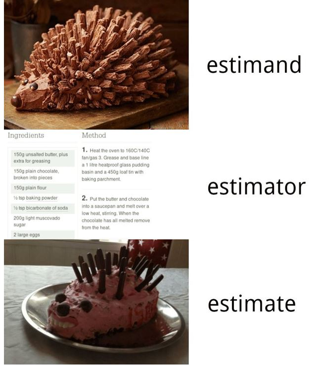

## Welcome back! {.title-slide}

<!-- MathJax macros for the whole deck. The reveal math plugin overwrites
     window.MathJax, so a header config would be clobbered; defining them in
     the first slide registers them before any later slide is typeset. The
     wrapper takes up no space and renders nothing. -->
::: {style="position:absolute;width:0;height:0;overflow:hidden;opacity:0"}
$$
\newcommand{\Var}{\text{Var}}
\newcommand{\Cov}{\text{Cov}}
\newcommand{\Corr}{\text{Corr}}
\newcommand{\indep}{\mathrel{\perp\mkern-10mu\perp}}
$$
:::


## Where we've been

::: {.prob-inf .hl-prob}

:::

::: {.attribution}
Adapted from @blackwell2025users, Ch. 2
:::

## Where we're going

::: {.prob-inf .hl-inf}

:::

::: {.attribution}
Adapted from @blackwell2025users, Ch. 2
:::


## Defining the population

::: {.incremental}

- Statistical **inference** is the task of learning about some feature of a target **population**
  - e.g. All U.S. voters
  - All voters *in Wisconsin*
  - All municipalities in the United States
  - All online reviews of restaurants
- The population is not (fully) observed
  - Otherwise we wouldn't need statistics!
- In the case of a **finite** population, we could imagine listing the total number of units in the population $N$
  - This is our **sampling frame** (e.g. the voter file)

:::

## Running Example: 2024 General Social Survey

::: {.incremental}

- Our running example for today is the **General Social Survey** - a nationally representative survey of U.S. adults that has been conducting annual interviews since 1972.
- **Target population**: U.S. adults (18+) living in noninstitutional housing, April--December 2024
- **Sampling frame**: the NORC 2020 National Sampling Frame
  - A list of housing units built mostly from the USPS delivery file 
  - Supplemented by NORC directly identifying addresses where USPS coverage is below 90%

:::

{fig-align="center" width="22%"}


## Defining the population

```{r}
#| echo: false
#| output: asis

# U.S. outline, then a grey square for every unit in the population
# (pop-anim/population.js; data from pop-anim/make_population.R)
source("pop-anim/embed.R")
pop_anim(c("outline", "grey"))
```


## Defining the estimand

::: {.incremental}

- Our goal is to learn about some **feature** of the target population.
- We might be interested in the **distribution** of some variable $Y$ in that population
  - Turnout
  - Vote choice
  - Restaurant review score
- Often we want a **summary** of that distribution
  - An **expected value**: $\mathbb{E}[Y]$
  - Or, if we have two variables, a **regression function**: $\mathbb{E}[Y | X]$ 
- This is our **quantity of interest** or **estimand**
  - Often denoted with a *greek letter*: $\mu$, $\theta$, $\tau$

:::

## Defining the estimand

```{r}
#| echo: false
#| output: asis

# Units take on their outcome, copies collapse into a pie of the population
# share (the estimand), and the pie shrinks to hover above the map
source("pop-anim/embed.R")
pop_anim(c("grey", "colored", "pie", "pieSmall"))
```

## Running Example: 2024 General Social Survey

- We'll focus on **self-reported** turnout in the 2020 U.S. presidential election

>  "In 2020, you remember that Joe Biden ran for President on the Democratic ticket against Donald Trump for the Republicans. Do you remember for sure whether or not you voted in that election?"

- Let $Y_i$ denote the response from population member $i$ ($Y_i = 1$ if voted, $Y_i = 0$ otherwise)
  - We want to know the **expected turnout** $\mathbb{E}[Y_i]$

$$ \mu = \mathbb{E}[Y_i] = \frac{1}{N} \sum_{i=1}^N Y_i $$


## Sampling design

::: {.incremental}

- We do not observe the population directly. Instead, we observe a **sample** from that population
  - Knowing the **sampling design** - how that sample was obtained - is **essential** to figuring out how what we calculate in sample relates to the target population.
- In statistics, we focus mainly on **probabilistic samples**
  - Let $Z_i = 1$ denote that unit $i$ is **sampled**
  - Let $n$ denote the size of the **sample**
- A **simple random sample** is a design where each sample of size $n$ has equal probability of occurring.
  - Let $\mathbf{Z} = (Z_1, \dotsc, Z_N)$ be the collection of sampling indicators

  $$P(\mathbf{Z}) = \begin{cases} \binom{N}{n}^{-1} & \text{if } \sum_{i=1}^N Z_i = n \\ 0 & \text{otherwise} \end{cases}$$

- $P(Z_i = 1) = \frac{n}{N}$ for all units.

:::

## Sampling design

::: {.incremental}

- A **Bernoulli** sampling design selects units by **independent** coin flips, each with some probability $p$

  $$ P(Z_i = 1) = p \quad \forall i \in \{1, 2, \dotsc, N\} $$

- What's the difference
  - Under a Bernoulli design, sample size $n$ is **random**. Under an SRS, it's **fixed**
  - Under a Bernoulli design, selection indicators are **independent**. Under an SRS, they're (slightly) **dependent**.

- What's the difference **in practice**
  - None. If $N$ is **very large** relative to $n$, the two designs are indistinguishable
  - Under an SRS, learning that $i$ was sampled barely changes the chance that $j$ was: $P(Z_j = 1 \mid Z_i = 1) = \frac{n-1}{N-1} \approx \frac{n}{N} = P(Z_j = 1)$
  - Under a Bernoulli design, $n$ concentrates around $Np$. Conditional on $n$, a Bernoulli sample **is** an SRS.
  - e.g. the GSS: $n \approx 3{,}300$ out of $N \approx 260$ million adults

:::

## Sampling design

::: {.incremental}

- Alternatively, we'll often describe our sampling design by characterizing the **distribution** from which the $Y_i$ in our sample are drawn.
  - (e.g.) $Y_i \sim ?(\mu, \sigma^2)$
  - Each $Y_i$ is a draw from some unknown distribution with finite mean $\mu$ and finite variance $\sigma^2$
- A key assumption that we'll make is that observations in sample are **independently and identically distributed** (i.i.d.)
  - **Identically** distributed: Our units are drawn from the **population distribution** of interest.
  - **Independently** distributed: Knowing one unit is included tells us nothing about the probability another is included.
- Under **Bernoulli** sampling, observations in the sample are independent
- Under a **simple random sample**, observations are approximately independent (as population size gets arbitrarily large relative to sample, $N \to \infty$)

:::


## Running Example: 2024 General Social Survey

::: {.incremental}

- Real surveys are more involved. The 2024 GSS uses a **multi-stage cluster** design:
  1. Sample 74 **areas** (metros or groups of counties): 20 large areas with certainty, the rest w/ probability proportional to their number of housing units
  2. Within those, sample 400 **segments** (census tracts or block groups) (proportional to number of housing units)
  3. Within segments, sample 13,900 **addresses** so that every housing unit has the same chance of selection
  4. Within each responding household, select **one adult** at random
- This is **not** an SRS of adults
  - **Unequal probabilities**: an adult in a three-adult household is 1/3 as likely to be selected as one who lives alone
  - How do they correct this? **Weights!**

:::

::: {.attribution}
Source: 2024 GSS Cross-section Codebook, Release 3 (NORC), pp. 39--48
:::

## Sampling design

```{r}
#| echo: false
#| output: asis

# A simple random sample is picked out of the population, and copies of the
# sampled units move into a sample box
source("pop-anim/embed.R")
pop_anim(c("pieSmall", "selected", "sampled"))
```

## Estimators

::: {.incremental}

- Once we have an **estimand** in mind, we want to figure out the *algorithm* to transform our sample of observations into a **best guess**.
  - Consider a **sample** of size $n$ with observations indexed by $i = \{1,2, 3, \dotsc n\}$
- An **estimator** is a **function** of our sample.
  - It's a random variable too!
- Since we're targeting the **population mean**, a natural choice for an estimator would be the **sample mean**

  $$ \hat{\mu} = \bar{Y}_n = \frac{1}{n} \sum_{i=1}^n Y_i $$


- We'll often denote estimators with a **hat** put on top of the greek letter for the estimand: $\hat{\mu}$, $\hat{\theta}$, $\hat{\tau}$
  - Means are also often denoted with a **bar** on top of the variable

:::


## Estimates

```{r}
#| include: false
#| ref.label: gss-est
```

::: {.incremental}

- An **estimate** is a single *realization* of an estimator
  - It's the **number** that you calculate for **your** dataset.
- In the GSS, $n = `r format(est$n, big.mark = "{,}")`$ respondents say whether they voted in 2020. The **sample mean** is

  $$\hat{\mu} = \bar{Y}_n = \frac{1}{n} \sum_{i=1}^n Y_i = `r sprintf("%.3f", est$ybar)`$$

- An alternative estimator is the **weighted** mean using the **survey weight** $w_i$

  $$\hat{\mu}_w = \frac{\sum_{i=1}^n w_i Y_i}{\sum_{i=1}^n w_i} = `r sprintf("%.3f", est$ybar_w)`$$

:::

## Estimates in R

```{r}
#| label: gss-est
#| echo: true
#| message: false

library(tidyverse)

gss <- read_csv("data/gss2024.csv") |>
  filter(!is.na(voted20))   # said whether they voted in 2020

est <- gss |>
  summarize(n = n(),
            ybar = mean(voted20),
            ybar_w = weighted.mean(voted20, weight))
est
```

## Estimators are random variables

```{r}
#| echo: false
#| output: asis

# Pick up from the "Sampling design" slide: the sample becomes a pie of its
# sample mean, filed in a column on the right; then new samples are drawn and
# filed the same way. Clicks: (1) make room and form the pie, (2) file it,
# (3)-(4) samples 2 and 3, (5) samples 4-10 at speed
source("pop-anim/embed.R")
pop_anim(list(
  "sampled",
  list(chain = I(c("1:cmp", "1:spie"))),
  "1:sdone",
  list(chain = I(sampling_round(2))),
  list(chain = I(sampling_round(3))),
  list(chain = I(unlist(lapply(4:10, sampling_round))), speed = 0.4)
))
```

## Estimation

{fig-align="center" height="500px"}

## Estimation

::: {.incremental}

- How do we know if we've picked a good estimator? 
  - Will it be close to the truth? 
  - Will it be systematically higher or lower than the target?
- We cannot answer this question from our **sample** alone - we need theory.
- In statistics, we study the **properties** of estimators
  - **Bias**: $\mathbb{E}[\hat{\mu}] - \mu$
  - **Variance**: $\Var(\hat{\mu})$
  - **Consistency**: Does $\hat{\mu}$ converge in probability to $\mu$ as $n$ goes to infinity?
  - **Asymptotic distribution**: Is the sampling distribution of $\hat{\mu}$ well approximated by a known distribution?

:::

## Estimation

{fig-align="center" height="500px"}

## Unbiasedness of the sample mean

::: {.incremental}

- Assume that each of our observations in the sample $Y_i \sim ?(\mu, \sigma^2)$ come from the **same** population with a **finite** mean.
- Can we show that this estimator has zero **bias**
  - In other words, is it's **expected value** equal to the true parameter value.
- Start by writing down our estimator and taking the expectation

  $$\mathbb{E}[\hat{\mu}] = \mathbb{E}\left[\frac{1}{n}\sum_{i=1}^n Y_i\right]$$

- Next we use linearity of expectations

  $$\mathbb{E}[\hat{\mu}] = \mathbb{E}\left[\frac{1}{n}\sum_{i=1}^n Y_i\right] = \frac{1}{n}\mathbb{E}\left[\sum_{i=1}^n Y_i\right] = \frac{1}{n}\sum_{i=1}^n \mathbb{E}\left[Y_i\right]$$

:::

## Unbiasedness of the sample mean

::: {.incremental}

- Finally, under our assumption that all $Y_i$ come from the population of interest with expectation $\mu$

  $$\frac{1}{n}\sum_{i=1}^n \mathbb{E}\left[Y_i\right] = \frac{1}{n}\sum_{i=1}^n \mu = \frac{n \mu}{n} = \mu$$

- Therefore, the bias, $\text{Bias}(\hat{\mu}) = \mathbb{E}[\hat{\mu}] - \mu = 0$

:::

## Unbiasedness of the sample mean

```{r}
#| echo: false
#| output: asis

# Pick up from "Estimators are random variables": clear the map and box, bring
# the population pie to centre stage, drop the sample pies onto a baseline at
# their sample means, mark the truth (dashed) and the sample means (dotted),
# then merge the sample means into their average (solid gold)
source("pop-anim/embed.R")
pop_anim(c("10:sdone", "hfade", "hist", "hlines", "havg"))
```

## Sampling variance of the sample mean

::: {.incremental}

- What else can we learn about the distribution of an estimator?
  - Remember, an **estimator** is a random variable.
  - We'll refer to the distributions of estimators as **sampling distributions**
- We've established $\mathbb{E}[\hat{\mu}]$...now what about $\Var(\hat{\mu})$?
  - How far do draws from our estimator tend to land from its expectation?
- Why do we want to know this?
  - So we can characterize the degree of **uncertainty** in our particular realization of the estimator.
  - Confidence intervals, hypothesis tests, etc... (next few weeks!)

:::

## Sampling variance of the sample mean

::: {.incremental}

- Let's take the variance of $\hat{\mu}$

  $$\Var(\hat{\mu}) = \Var\left(\frac{1}{n}\sum_{i=1}^n Y_i\right)$$

- Constants come out of a variance **squared**

  $$\Var(\hat{\mu}) = \Var\left(\frac{1}{n}\sum_{i=1}^n Y_i\right) = \frac{1}{n^2}\Var\left(\sum_{i=1}^n Y_i\right)$$

- The variance of a sum is the sum of the variances **plus** all of the covariances

  $$\frac{1}{n^2}\Var\left(\sum_{i=1}^n Y_i\right) = \frac{1}{n^2}\left[\sum_{i=1}^n \Var(Y_i) + \sum_{i=1}^n \sum_{j \neq i} \Cov(Y_i, Y_j)\right]$$

:::

## Sampling variance of the sample mean

::: {.incremental}

- Under **independence**, all of the covariance terms are zero: $\Cov(Y_i, Y_j) = 0$ for $i \neq j$

  $$\frac{1}{n^2}\left[\sum_{i=1}^n \Var(Y_i) + \sum_{i=1}^n \sum_{j \neq i} \Cov(Y_i, Y_j)\right] = \frac{1}{n^2}\sum_{i=1}^n \Var(Y_i)$$

- Under the assumption that each observation comes from the **same** target distribution, every observation has the same **population** variance $\Var(Y_i) = \sigma^2$

  $$\frac{1}{n^2}\sum_{i=1}^n \Var(Y_i) = \frac{1}{n^2}\sum_{i=1}^n \sigma^2 = \frac{n\sigma^2}{n^2} = \frac{\sigma^2}{n}$$

:::

## Sampling variance of the sample mean

::: {.incremental}

- So under i.i.d sampling, our **sampling variance** is

 $$\Var(\hat{\mu}) = \frac{\sigma^2}{n}$$
- We'll often talk about the standard deviation (square root of the variance) of a sampling distribution
  - For estimators we refer to this particular standard deviation as a **standard error**

  $$ \text{SE}(\hat{\mu}) = \sqrt{\Var(\hat{\mu})} = \frac{\sigma}{\sqrt{n}} $$

- Note what we needed for unbiasedness: **identical** sampling
  - But this variance expression requires: **identical** and **independent** draws.
  - What happens with dependence? We'll have a *different* expression for the standard error.

- What happens as $n$ gets large?
  - The **standard error** gets smaller! Our estimator becomes more **precise**.

:::

## Sampling variance of the sample mean

```{r}
#| echo: false
#| output: asis

# Pick up from "Unbiasedness of the sample mean": shrink the n = 25 histogram
# into the top row, then rerun the sampling for n = 50 and n = 100 (one round
# at a watchable pace, the other nine fast) and drop each size's pies into
# its own row; finish with a bar under each row spanning its sample means
source("pop-anim/embed.R")
pop_anim(list(
  "havg",
  list(chain = I(c("m0", "back.1"))),
  list(chain = I(sampling_round(1, set = 2)), speed = 0.7),
  list(chain = I(unlist(lapply(2:10, sampling_round, set = 2))), speed = 0.22),
  "hist.2",
  "back.2",
  list(chain = I(sampling_round(1, set = 3)), speed = 0.7),
  list(chain = I(unlist(lapply(2:10, sampling_round, set = 3))), speed = 0.22),
  "hist.3",
  "bands"
))
```

## Asymptotic properties

::: {.incremental}

- Another way of talking about properties of estimators is to consider how they **behave** as the sample size gets large.
  - Sometimes this is just *easier* than working with finite sample expectations.
  - Additionally, we might have a **biased** estimator. Does that bias "go away" in large samples?

- This requires us to talk about **sequences** of estimators indexed (typically) by sample size.
  - We'll typically denote this sequence with a subscript - for example, for the sample mean...

  $$\bar{Y}_n = \{\bar{Y}_1, \bar{Y}_2, \bar{Y}_3, \dotsc\}$$

- Can we characterize the **limit** of this sequence of estimators?
  - It's a **random variable**...so we need a slightly different language compared to deterministic series.
  - But a lot of intuitions from convergence of series carry over!

:::

## Convergence in probability

::: {.incremental}

- First, we can talk about the convergence of a sequence to a single **value**
  - There are lots of different forms of convergence here, but the most common that we use is **convergence in probability**
- **Convergence in probability**
  - A sequence of random variables $\hat{\mu}_n$ is said to **converge in probability** to some value $\mu$ if for every $\epsilon > 0$,

    $$\Pr(|\hat{\mu}_n - \mu| \ge \epsilon) \to 0$$
  as $n \to \infty$.

- We'll denote this as $\hat{\mu}_n \xrightarrow{p} \mu$. You'll see other texts use the term "plim"
- An **estimator** that converges in probability to the target estimand is called **consistent**.

:::

## Weak Law of Large Numbers

::: {.incremental}

- The **weak law of large numbers** states that the sample means of independent and identically distributed random variables...
  - ... **converge in probability** to their population **expected value**
  - Assuming finite population mean and variance

- Let's prove this!

  $$Pr(\bigg(\bar{Y}_n  - \mu \bigg| \ge \epsilon) \to 0 $$

- The trick will rely on a known **bound** on how far a random variable can fall from its mean: **Chebyshev's Inequality**
  - This bound depends on the **variance** of that random variable.
  - And we've already shown that the variance of $\hat{\mu} = \frac{1}{n}\sum_{i=1}^n Y_i$ **goes to zero** as $n$ gets large.

:::

## Properties of convergence in probability

- Consider two sequences $X_n \xrightarrow{p} x$ and $Y_n \xrightarrow{p} y$ and continuous function $g()$. By the continuous mapping theorem

1. $X_n + Y_n \xrightarrow{p} x + y$
2. $X_nY_n \xrightarrow{p} xy$
3. $X_n/Y_n \xrightarrow{p} x/y$ if $y \neq 0$
4. $g(X_n) \xrightarrow{p} g(x)$

## Next week

::: {.incremental}

- Estimation, continued
  - Convergence in distribution and the **central limit theorem**
  - **Plug-in** estimators
  - Density estimation

:::

## References {.refs-slide}

::: {#refs}
:::
